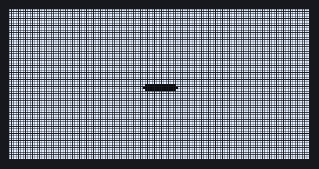
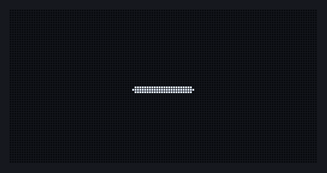
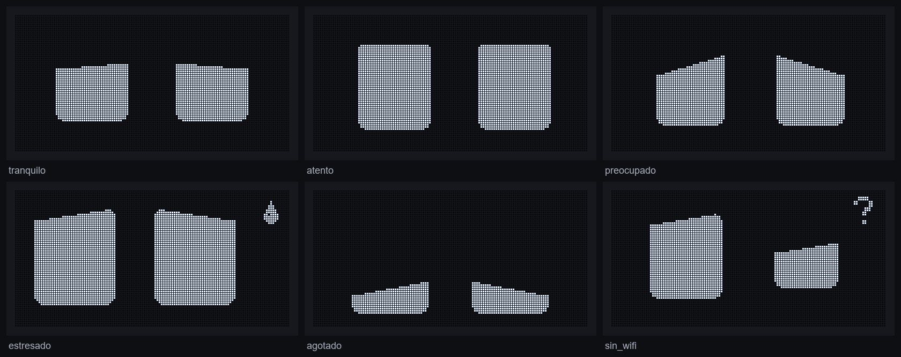
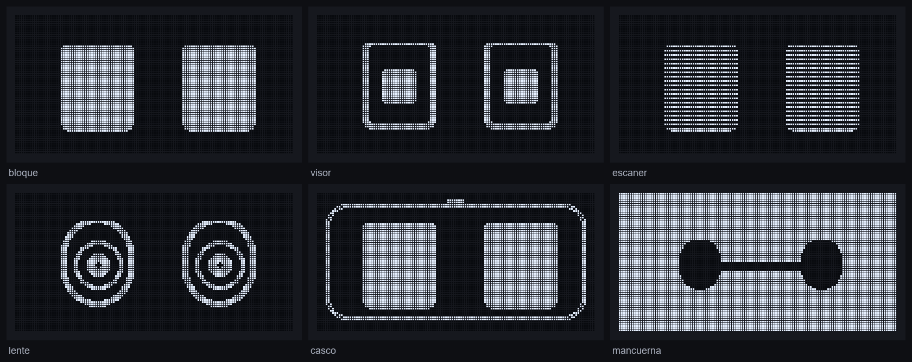

# OLED Eyes — an expressive pair of eyes on a $3 display

A 128×64 monochrome OLED shows a pair of animated eyes that react to how much of my Claude Code quota I've used:
relaxed, attentive, worried, stressed, exhausted. They blink, glance around, yawn, sneeze and get dizzy, all on an
ESP32-C3 or an ESP8266.

<p align="center">
  
  
</p>

> The images in this README are rendered **from the real firmware code** on a PC (see [Previews](#previews)).

## Moods

Quota usage maps to five moods (with hysteresis on the way down), plus system states for WiFi and missing data.



## Styles

The same parameters drive six visual styles.



## How it works

- **Parametric eyes.** Each eye is described by 18 parameters (size, corner radius, upper/lower lids and tilt, pupil,
  highlight, offset, rotation, shape) plus 11 face-level ones (gaze, shake, sweat, Zzz, question mark, sparkles…).
  A pose is just an array of 47 floats.
- **Layered animation engine** ([`src/eyes_machine.h`](src/eyes_machine.h)), evaluated every tick in this order:
  1. base pose (mood or system state, with eased transitions: anticipate-overshoot going up, ease-in-out going down)
  2. active animation (keyframes with per-key easing that patch the base)
  3. blinking (single/double, timing depends on mood)
  4. saccades (soft, micro, restless, ping-pong)
  5. random idles (yawn, look around, suspicious, sneeze)
- **Data-driven.** Poses, patches and animations live in [`src/oled_eyes_data.h`](src/oled_eyes_data.h), generated
  from a design-system file, so tuning an expression doesn't touch the engine.
- **Safe rendering.** [`src/oled_buf.h`](src/oled_buf.h) draws straight into the U8g2 page buffer with signed,
  clipped coordinates (U8g2's own primitives wrap around with negative values).
- **Panel care.** The Mancuerna style lights ~95 % of the pixels, so the panel is inverted in hardware, dimmed after
  10 min without changes, and has an optional night schedule.
- **Interaction.** A button tap triggers *tickles*; three quick taps trigger a spin.

## Architecture

```
PC (bridge.py) ──POST /update {percent}──▶ ESP32-C3 / ESP8266 ──I2C──▶ SSD1306 128×64
                                             ├─ eyes_machine.h  mood + animation layers
                                             ├─ oled_eyes.h     easing, evaluation, render
                                             └─ oled_buf.h      clipped drawing primitives
```

HTTP endpoints on the board: `POST /update`, `POST /egg`, `GET /status`, `GET /` (status page).

`bridge.py` reads the active 5-hour block from [ccusage](https://github.com/ryoppippi/ccusage) and posts the
percentage. Calibrate `TOKEN_LIMIT` against Claude Code's `/usage`.

## Build

```bash
cp include/secrets.example.h include/secrets.h   # set your WiFi
pio run -e esp32c3 -t upload       # ESP32-C3 SuperMini / DevKitM-1 (30 fps)
pio run -e nodemcuv2 -t upload     # NodeMCU v3 / ESP8266 (20 fps)
```

| Board | SDA | SCL | Button |
|---|---|---|---|
| ESP32-C3 | GPIO8 | GPIO9 | GPIO4 |
| NodeMCU v3 | D2 (GPIO4) | D1 (GPIO5) | GPIO0 (FLASH) |

## Previews

The engine has no Arduino dependencies, so [`tools/preview.cpp`](tools/preview.cpp) compiles it on a PC, runs the
state machine and dumps raw frames. [`tools/make_previews.py`](tools/make_previews.py) turns them into the GIFs and
sheets above.

```powershell
cd tools
.\build_preview.bat          # MSVC; or: g++ -O2 -std=c++17 preview.cpp -o preview
python make_previews.py
```

## License

[MIT](LICENSE)
